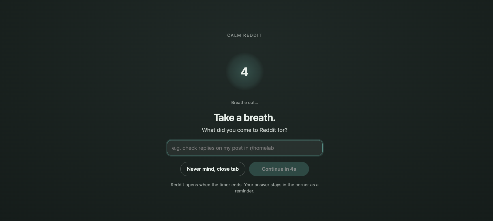

# Calm Reddit



Makes Reddit less addictive without blocking it, unless you ask it to.

## What it does

On by default:

- **Pages instead of infinite scroll:** 10 posts, then a "Next page" button. From page 3 on, the button unlocks after a random 3 to 6 seconds.
- **No recommendations:** suggested posts on Home, sidebars, "More posts you may like", trending searches, and the Popular / Explore / All links. Those feeds still open (paginated) if you go there on purpose; to keep them out, use **Block pages**.
- **No numbers:** vote scores, comment counts and awards are hidden.
- **No ads:** promoted posts and ad slots are hidden.
- **Calmer media:** images and videos in feeds are blurred until you hover over them, and nothing autoplays.
- **Comments on demand:** post pages open with comments tucked behind a "Show comments" button.
- **A pause on the way in:** when you arrive after 15+ minutes away, a screen asks what you came for. It stays for a random 8 to 16 seconds, and sometimes asks you to solve a quick sum first, so you can't just wait it out by habit. What you write stays in the corner as a reminder, with how long you have been on Reddit. During a long visit, the screen comes back after a random 15 to 25 minutes to ask if you are still on task. The popup lists your last 1000 reasons. They stay on this device and are not synced.
- **Turning any protection off** in the popup makes you wait a random 8 to 16 seconds first.

Optional, in the popup:

- **Grayscale.**
- **Also hide:** sidebars, the Reddit logo, video & GIF posts.
- **Block pages:** Home feed, Popular & All, Explore, search results, subreddit feeds, other people's profiles, notifications. A blocked page shows a short note instead. Posts you open from a link still work.
- **Subreddit list:** allow only the subreddits you list, or block the ones you list.

## Install (Chrome, Edge, Brave, Arc)

1. Put this folder somewhere permanent, e.g. `Documents/calm-reddit`. Chrome runs the extension from that folder, so don't delete or move it afterwards.
2. Open `chrome://extensions` and switch on **Developer mode** (top right).
3. Click **Load unpacked** and choose the `calm-reddit` folder (the one containing `manifest.json`).
4. On the Calm Reddit card click **Details** and switch on **Allow in Incognito**. Chrome turns extensions off in Incognito unless you do this.
5. Pin it from the puzzle-piece menu so you can open its settings.

## Install (Safari on Mac, iPhone, iPad)

Safari 18 or later. Safari runs extensions only inside an app, so you build a small app with Xcode.

1. Install Xcode and Node.js. In this folder, run `npm run build`. This writes the Safari version to `dist/safari`.
2. Open `safari/Calm Reddit/Calm Reddit.xcodeproj` in Xcode.
3. **Mac:** select the **Calm Reddit (macOS)** scheme and click Run. Then, in Safari:
   - **Settings › Advanced:** tick **Show features for web developers**.
   - **Settings › Developer:** tick **Allow unsigned extensions**. Safari forgets this when it quits. Signing the app with your Apple developer team in Xcode (**Signing & Capabilities**) removes this step.
   - **Settings › Extensions:** turn on Calm Reddit and tick **Allow in Private Browsing**.
4. **iPhone or iPad:** select the **Calm Reddit (iOS)** scheme and a simulator or your device, then click Run. A real device needs an Apple Developer Program membership. On the device, open **Settings › Apps › Safari › Extensions › Calm Reddit**, turn it on, and switch on **Allow in Private Browsing**.
5. Open reddit.com, open Calm Reddit from the toolbar (Mac) or the page menu in the address bar (iPhone, iPad), and choose **Always Allow on This Website**. Safari does not let an extension change a website until you do this.

For a quick test on a Mac without Xcode, use **Safari › Settings › Developer › Add Temporary Extension…** and select `dist/safari`. Safari removes it after 24 hours or when it quits.

## Updating

**Chrome:** replace the files in the same folder (this keeps your settings and the Incognito permission), press the reload arrow on the Calm Reddit card in `chrome://extensions`, then refresh any open Reddit tabs.

**Safari:** run `npm run build`, click Run in Xcode again, then refresh any open Reddit tabs.

## If something slips through

Reddit changes its page structure from time to time. Open a Reddit tab where the problem shows, click the Calm Reddit icon, then **Copy diagnostics** at the bottom of the popup and send the result to whoever maintains your copy. It contains your Calm Reddit settings (including your subreddit list) and page-structure details (element names and counts), but no post titles, usernames or past reasons. It's only copied to your clipboard; nothing is sent anywhere.

## Development

Plain JavaScript. Chrome loads the files as they are. `npm run build` copies the same files into `dist/chrome` and `dist/safari`. The only difference is the manifest: `scripts/build.js` changes it for each browser.

The Xcode project in `safari/` wraps `dist/safari` in a Mac and iOS app. It refers to the `dist/safari` folders, so new files there are included without changes in Xcode. It was made once with `xcrun safari-web-extension-packager dist/safari --project-location safari --app-name "Calm Reddit" --bundle-identifier com.calmreddit.CalmReddit --swift`. Use your own bundle identifier before you publish to the App Store.

The popup and the welcome page show Chrome or Safari wording from `data-browser="chrome|safari"` on their elements.

| File | Runs in | Job |
| --- | --- | --- |
| `src/settings.js` | content script, popup, welcome page | `CALM_DEFAULTS` (every setting and its default) and `CALM_FEATURES` (setting → token on `<html>`) |
| `src/blocking.js` | content script, popup | Pure rules: which URLs are blocked, parsing the subreddit list |
| `src/bridge.js` | content script (isolated world) | Mirrors settings onto `<html data-calm-*>`, pause screen (on arrival and as a check-in during a visit), intention reminder with the time on Reddit, history of your reasons, blocked-page screen |
| `src/page.js` | Reddit's own JS world (`"world": "MAIN"`) | Pagination, shadow-DOM styles, autoplay blocking, flagging recommended / video posts, comments gate |
| `src/calm.css` | injected before Reddit renders | Everything that can be done with CSS, keyed off the `<html>` attributes |
| `popup/` | toolbar popup | Settings UI; every `input`/`select` with a `data-key` is wired automatically. Also lists your past reasons |
| `scripts/build.js` | Node, `npm run build` | Writes `dist/chrome` and `dist/safari` with each browser's manifest changes |
| `safari/` | Xcode | Mac and iOS app that carries the Safari extension |

Settings flow: popup → `chrome.storage.sync` → `bridge.js` → `<html data-calm-off="…" data-calm-on="…">` → `calm.css` and `page.js`.
Visit data (last time on Reddit, the current reason, the history of reasons) is in `chrome.storage.local`, so it stays on each device.
Protections (default on) are listed in `data-calm-off` while turned off, so they apply before settings load. Opt-in extras are listed in `data-calm-on` while turned on.

### Adding a setting

1. Add it with its default to `CALM_DEFAULTS` in `src/settings.js`.
2. If CSS or `page.js` needs to know about it, add a `[key, token]` pair to `CALM_FEATURES` and use `html[data-calm-off~="token"]` (default-on) or `html[data-calm-on~="token"]` (opt-in).
3. Add a checkbox or select with `data-key="yourKey"` to `popup/popup.html`. Unticking asks for the cool-down unless the checkbox has `data-instant`.
4. For a new blocked page, add the rule to `calmBlockReason` in `src/blocking.js` and a case to `tests/unit/blocking.spec.js`.
5. Bump `version` in `manifest.json` and `package.json`.

### Tests

```sh
npm install
npx playwright install chromium
npm run test:unit   # URL rules, offline, under a second
npm run test:e2e    # live reddit.com with the extension loaded (~3 min)
npm test            # both
```

The end-to-end tests open a real Chromium window, because Reddit answers headless browsers with a "Prove your humanity" page. They need network access, and because they run against the live site, a Reddit redesign can break them. When that happens, look at the failure's trace (`npx playwright show-trace test-results/…/trace.zip`) and the popup's diagnostics.
